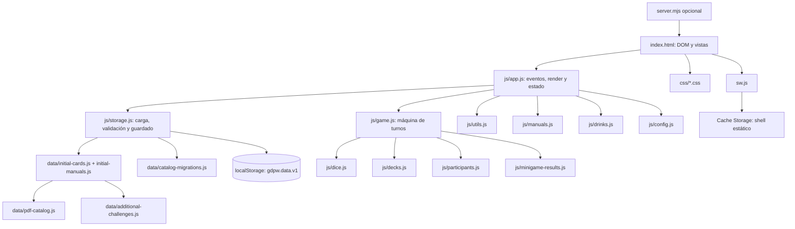

# Arquitectura y funcionamiento

## Arquitectura observada



## Punto de entrada y carga

`index.html:1-31` establece idioma, viewport, manifest, iconos y cuatro hojas CSS. Las vistas y controles están declarados en el documento; `index.html:474` inicia `js/app.js` como `type="module"`. Este importa configuración, almacenamiento, motor, utilidades, bebidas, manuales, dado y validación de minijuegos (`js/app.js:1-15`). Al evaluar módulo, `loadState()` carga/crea estado, `gameEngine(state)` adapta estado existente, se conectan eventos y al final `render()` actualiza las vistas (`js/app.js:16-31,66-73,1300-1313`).

## Flujo de estado y persistencia

```text
index.html → js/app.js → js/storage.js → localStorage
                         ↘ data/initial-cards.js → data/pdf-catalog.js + data/additional-challenges.js
                         ↘ data/catalog-migrations.js
```

`seedState()` clona catálogo y manuales iniciales e inicializa bebidas, participantes, ajustes y partida (`js/storage.js:12-35`). `loadState()` lee `gdpw.data.v1`, valida estructura y cartas, aplica migración de catálogos antiguos e incorpora IDs nuevos cuando corresponde (`js/storage.js:84-168`). `persist()` en `app.js:30-39` serializa por `saveState()` a localStorage (`storage.js:171-178`). No se sincroniza entre dispositivos. La importación de respaldo reemplaza estado en memoria tras validar lo esencial; catálogo JSON se agrega solo si pasa validación y no repite IDs (`app.js:1165-1210`, `storage.js:180-295`).

## Flujo de partida

```text
index.html → js/app.js (evento de usuario) → js/game.js
  → js/dice.js (roll digital) / js/decks.js (robo)
  → js/participants.js (destinatarios)
  → js/minigame-results.js (resultados y cola de consecuencias)
  → app.js persist/render → js/storage.js → localStorage
```

El dado digital elige una cara y crea turno en fase `ROLLING`; `app.js` anima el cubo durante 4 s y luego llama `completeRoll()` (`game.js:126-150`; `app.js:1040-1089`). El usuario pulsa el mazo correspondiente; en `draw()` se obtiene carta mediante `attachCard()` y `drawFromDeck()`, se calcula destinatario, y se guarda carta primaria o auxiliar en el turno (`game.js:17-51,294-374`; `decks.js:2-33`; `participants.js:4-30`). El resultado se registra con `resolve()`, y la finalización explícita ejecuta historial, recompensas, avance y desbloqueo (`game.js:376-497`). Cada acción de UI persiste y renderiza.

## Recorrido de edición

`index.html` contiene formulario/lista (`index.html:226-257,345-435`) → eventos de `app.js` → `populateForm`, `saveCard`, `validateCards`, `renderCards` (`app.js:608-784`) → objeto en `state.cards` → `persist()` → `storage.js`. El importador usa `file.text()`, `JSON.parse`, `parseCardImport`; no ejecuta contenido de archivo (`app.js:1165-1182`; `storage.js:281-295`). Exportar crea Blob y descarga mediante `downloadJSON()` (`utils.js:21-30`).

## PWA y servidor

`manifest.json` aporta nombre, inicio, orientación e iconos. `app.js:1281-1306` registra `sw.js` fuera de `file:` si existe soporte, y gestiona `beforeinstallprompt`. `sw.js:1-79` precachea lista `SHELL` en instalación, elimina cachés anteriores con prefijo en activación y usa red primero para GET del mismo origen, recurriendo a Cache Storage y luego a `index.html` cuando falla. `server.mjs:1-40` implementa servidor HTTP Node con MIME para HTML/JS/CSS/JSON/SVG/PNG, protección de ruta raíz y 404 genérico.

## Estado, eventos y errores

Estado mutable único reside en `js/app.js` y se comparte con `gameEngine`. Las vistas se regeneran con `render()`. Eventos DOM se enlazan por asignación de `onclick/onchange/onsubmit` y un listener delegado de navegación (`app.js:961-968,1000-1306`). Errores de almacenamiento se capturan en `storage.js`; errores de acciones se traducen a notificaciones en `app.js`. No hay autenticación/autorización ni backend.

## Actualización fase 1

`gameEngine` incorpora repetición del dado antes de revelar carta y sustitución de una carta por otra de la misma categoría. `app.js` contiene el temporizador independiente basado en `Date.now()`. No se añadió red, backend ni Supabase.

En el ajuste de interfaz del 2026-11-02, el cubo pasó a ser el control para tirar/repetir. También permite reemplazar una carta principal del mismo mazo. La carta principal y las auxiliares extraídas se muestran juntas dentro de `#turn-cards`, con deslizamiento horizontal y centrado por `scroll-snap`; se quitó la sección duplicada de cartas extraídas. El motor rechaza reemplazar Premio/Castigo y permite repetir la cara BLOQUEADA mientras el turno no se haya cerrado.
