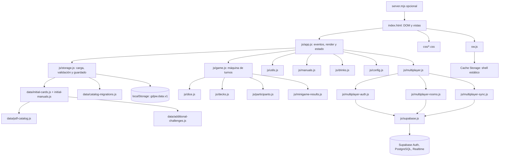

# Arquitectura y funcionamiento

## Arquitectura observada



## Punto de entrada y carga

`index.html:1-36` establece idioma, viewport, manifest, iconos, CSS y SDK Supabase async; `index.html:530` inicia `js/app.js` como módulo. Este importa configuración, almacenamiento, motor, utilidades, bebidas, manuales, dado, validación de minijuegos y orquestador multiplayer (`js/app.js:1-25`). Al evaluar el módulo, `loadState()` carga/crea estado y `gameEngine(state)` lo adapta (`js/app.js:27-39`); los eventos de interfaz se enlazan y `render()` actualiza las vistas (`js/app.js:1400-1948,501-515`).

## Flujo de estado y persistencia

```text
index.html → js/app.js → js/storage.js → localStorage
                         ↘ data/initial-cards.js → data/pdf-catalog.js + data/additional-challenges.js
                         ↘ data/catalog-migrations.js
```

`seedState()` clona catálogo y manuales iniciales e inicializa bebidas, participantes, ajustes y partida (`js/storage.js:12-37`). `loadState()` lee `gdpw.data.v1`, valida estructura y cartas, aplica migración de catálogos antiguos e incorpora IDs nuevos cuando corresponde (`js/storage.js:85-170`). `persist()` de `app.js:86-97` conserva ruta local hacia `saveState()` (`storage.js:172-180`); online evita escribir ese estado local y usa ruta remota solo al anfitrión. La importación de respaldo está en `app.js:1818-1844`; catálogo JSON usa `parseCardImport()` (`storage.js:289-303`).

## Flujo de partida

```text
index.html → js/app.js (evento de usuario) → js/game.js
  → js/dice.js (roll digital) / js/decks.js (robo)
  → js/participants.js (destinatarios)
  → js/minigame-results.js (resultados y cola de consecuencias)
  → app.js persist/render → js/storage.js → localStorage
```

El dado digital elige una cara y crea turno en fase `ROLLING`; `startDigitalRoll()` anima el cubo 1.35 s y después llama `completeRoll()` (`game.js:126-160`; `app.js:1635-1685`). El usuario pulsa el mazo correspondiente; `draw()` obtiene carta mediante `attachCard()`/`drawFromDeck()`, calcula destinatario y guarda carta primaria o auxiliar (`game.js:17-50,311-392`; `decks.js:2-33`; `participants.js:4-30`). El resultado se registra con `resolve()` y `finishTurn()` escribe historial/recompensas y avanza (`game.js:427-516`). Cada acción de UI persiste y renderiza.

## Recorrido de edición

`index.html` contiene formulario/lista de cartas → eventos de `app.js` → `populateForm()` (`app.js:1170`), `saveCard()` (`1227-1288`), `renderCards()` (`1289-`) → objeto `state.cards` → `persist()` → `storage.js`. La importación JSON usa `file.text()`, `JSON.parse`, `parseCardImport()`; no ejecuta el archivo como código (`app.js:1787-1813`; `storage.js:289-303`).

## PWA y servidor

`manifest.json` aporta nombre, inicio, orientación e iconos. `app.js:1931-1946` registra `sw.js` fuera de `file:` si existe soporte. `sw.js:1-84` precachea `SHELL` en instalación, elimina cachés anteriores con prefijo en activación y usa red primero para GET del mismo origen, recurriendo a Cache Storage y luego a `index.html` cuando falla. `server.mjs` implementa el servidor HTTP Node.

## Estado, eventos y errores

Estado mutable de la vista reside en `js/app.js` y se comparte con `gameEngine`. En modo local, `persist()` guarda con `saveState()`; en modo online, `persist()` envía el snapshot solo si el cliente es anfitrión. `enterOnlineMode()` clona el estado local y lo conserva en `localModeBackup`; `leaveOnlineMode()` restaura estado, motor y temporizador locales. El motor del host es autoridad; otros clientes reciben el snapshot y los controles de juego se vuelven de solo lectura (`js/app.js:51-89,117-148,174-214`).

## Flujo completo de multijugador

```text
index.html (SDK async + panel Participantes)
  → js/app.js (submit Crear/Unirme y estado online aislado)
  → js/multiplayer.js (espera SDK, organiza servicios y sesión)
  → js/multiplayer-auth.js (signInAnonymously + perfil)
  → js/multiplayer-rooms.js (RPCs y lecturas protegidas)
  → Supabase PostgreSQL (rooms, room_players, game_states)
  → js/multiplayer-sync.js (Postgres Changes + Presence privada)
  → js/app.js (aplica snapshot / temporizador / render)
```

Trazabilidad: el SDK CDN se declara asíncrono en `index.html:14-19`; el panel y sus controles están en `index.html:224-246`. `connectOnlineRoom()` y los handlers de crear/unirse/iniciar/transferir/cerrar/salir están en `js/app.js:243-340`. `connectRoom()` espera el SDK, inicia identidad anónima, guarda perfil, crea/ingresa a sala, suscribe el canal, lee el snapshot y guarda el código de reconexión (`js/multiplayer.js:4-136`).

`ensureAnonymousIdentity()` y `saveProfile()` hacen la autenticación y perfil (`js/multiplayer-auth.js:3-31`). `createRoom`, `joinRoom`, `beginRoomGame`, `saveRoomGame`, `leaveRoom`, `claimHost` y `closeRoom` llaman RPCs; `readRoom()` consulta sala, roster y estado (`js/multiplayer-rooms.js:7-94`). `subscribeRoom()` registra los cambios de `game_states`, `room_players`, `rooms` y Presence (`js/multiplayer-sync.js:3-45`). El cliente recibe cada snapshot por `applyOnlineSnapshot()` (`js/app.js:183-223`) y el anfitrión guarda por `scheduleRoomState()` con comparación de versión (`js/multiplayer.js:104-136`, `supabase/sql/003_multiplayer_functions.sql:127-159`).

Los scripts `supabase/sql/001`–`004` crean tablas/RLS, políticas, funciones RPC y publicación Realtime, en ese orden. La app no contiene credenciales `service_role`; el archivo `js/supabase.js` usa URL y clave pública `anon`.

## Actualización fase 1

`gameEngine` incorpora repetición del dado antes de revelar carta y sustitución de una carta por otra de la misma categoría. `app.js` contiene temporizador basado en `Date.now()` y sincroniza su hora de finalización en modo online.

En el ajuste de interfaz del 2026-11-02, el cubo pasó a ser el control para tirar/repetir. También permite reemplazar una carta principal del mismo mazo. La carta principal y las auxiliares extraídas se muestran juntas dentro de `#turn-cards`, con deslizamiento horizontal y centrado por `scroll-snap`; se quitó la sección duplicada de cartas extraídas. El motor rechaza reemplazar Premio/Castigo y permite repetir la cara BLOQUEADA mientras el turno no se haya cerrado.
